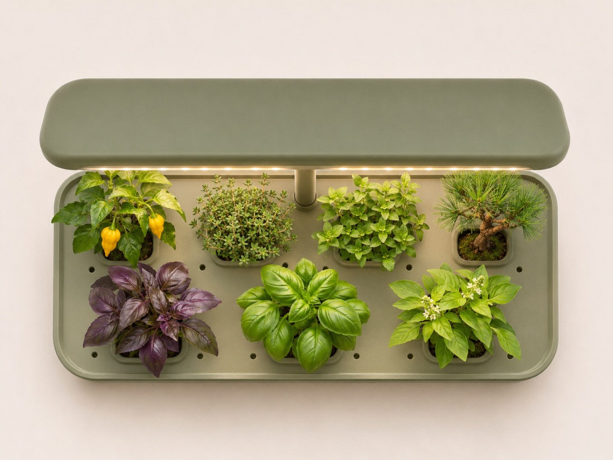
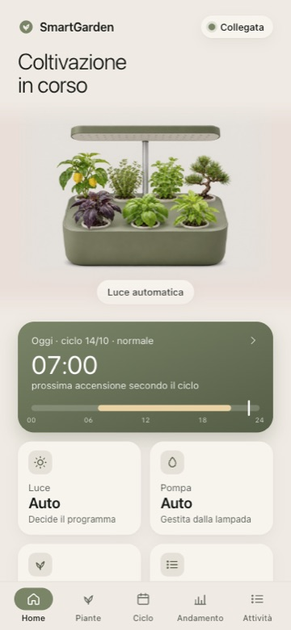
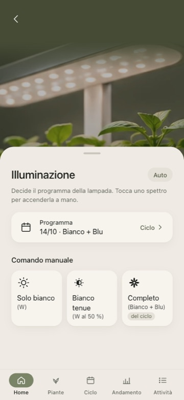
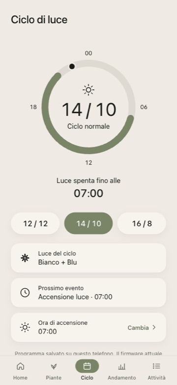
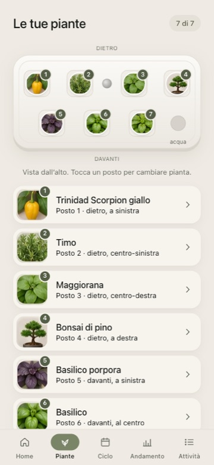
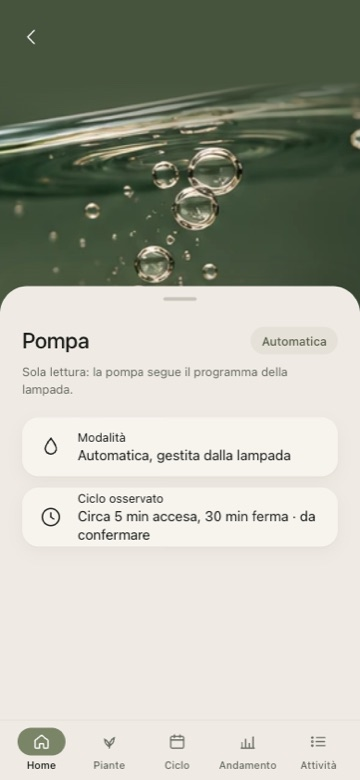
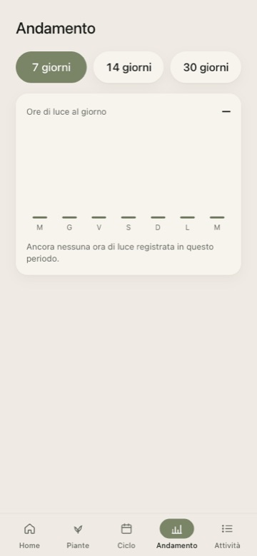
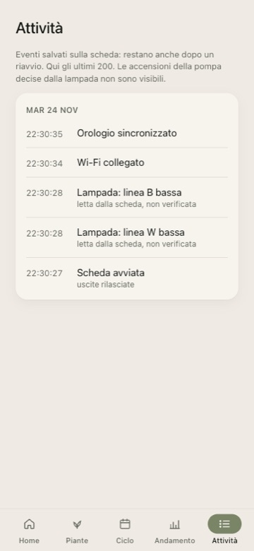
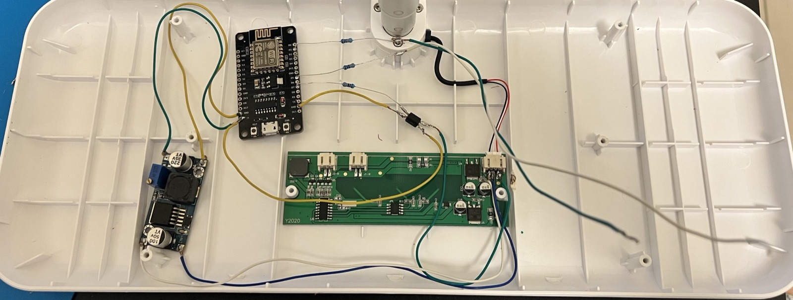

<div align="center">



# SmartGarden

**A Duronic GHS37 hydroponic garden, rewired from the inside and run from a phone.**

An ESP8266 hidden in the lamp head drives the lamp's own LED and pump stages, serves a
mobile app over Wi-Fi at `http://smartgarden.local`, and keeps a log of everything it does.

</div>

---

## What it does today

| | |
|---|---|
| **Light** | Switch the white and blue LED channels from the app: white only, white at 50 % (PWM), or full spectrum. Tap the active choice again to give control back to the lamp. |
| **Light cycle** | The board runs it by itself: 12/12, 14/10 or 16/8 from a chosen hour, each with its light as in the scenes of the original project (12/12 white at 50 %, 14/10 white + blue, 16/8 white). Settings live on the board, so the light follows the cycle after a power cut with no phone and no button press. A manual choice in the app wins until the next scheduled on/off. |
| **Plants** | A top view of the seven pods, numbered 1–7. Set the plant and the sowing date of each pod; the app counts the days. Saved on the board (EEPROM), so every phone sees the same garden. |
| **History** | The board counts the minutes of light of every day (cycle, manual or the lamp's own) and keeps 60 days in EEPROM; the app shows them as hours per day. Every command, boot, Wi-Fi change and cycle change is also saved in an activity log that survives reboots and app updates (`firmware/tools/log.sh` prints it on a computer). |
| **Pump** | Read-only: the lamp runs it by itself (observed: about 5–6 min on, 30 min off). |
| **Install** | Open `http://smartgarden.local` in Safari → Share → *Add to Home Screen*: full screen, own icon, no browser bars. The app reloads itself when a new version is uploaded. |

## The app

<table>
<tr>
<td></td>
<td></td>
<td></td>
<td></td>
</tr>
<tr>
<td align="center"><b>Home</b><br><sub>today's light, state at a glance</sub></td>
<td align="center"><b>Lighting</b><br><sub>white, white 50 %, full</sub></td>
<td align="center"><b>Light cycle</b><br><sub>24 h dial, cycle and its light</sub></td>
<td align="center"><b>Plants</b><br><sub>seven pods, editable</sub></td>
</tr>
<tr>
<td></td>
<td></td>
<td></td>
<td></td>
</tr>
<tr>
<td align="center"><b>Pump</b><br><sub>read-only</sub></td>
<td align="center"><b>History</b><br><sub>hours of light per day</sub></td>
<td align="center"><b>Activity</b><br><sub>persisted event log</sub></td>
<td></td>
</tr>
</table>

Warm off-white surfaces, a muted olive green taken from a ceramic pot, and nothing on
screen that the device cannot actually do: controls without a function are not shown and
no number is made up. The garden is a generated render seen from above and in front, with the real pod layout
(lights on and off cross-fade with the real light state); its olive finish is a design
choice, the real unit is white.

## How it works

```
 iPhone (Safari / Home Screen app)
        │  Wi-Fi, http://smartgarden.local  (mDNS)
        ▼
 NodeMCU ESP8266 ── inside the lamp head ─────────────────────────────┐
 │  LittleFS: the app (/www) + the event log (/log)                   │
 │  D1 ──330 Ω──▶ W stage  (white + red LEDs)   on / PWM / released   │
 │  D5 ──330 Ω──▶ B stage  (blue LEDs)          on / released         │
 │  D7 ──PC817C─▶ J3 C     (pump command)       see "Pump" below      │
 │  LM2596: 24 V ─▶ 5 V                                               │
 └────────────────────────────────────────────────────────────────────┘
        ▲
 Duronic lamp board: its own MCU, touch keys and transistors keep working
```

The board can only **add** "on" to a channel; when it releases a pin (input mode) the
lamp's own controller decides again. Every output is off from power-up until the firmware
drives it on purpose.

## The hardware

<table>
<tr>
<td width="50%"></td>
<td width="50%"></td>
</tr>
<tr>
<td align="center"><sub>The Duronic GHS37 (seen from behind): seven pods, one pole, flat lamp head.</sub></td>
<td align="center"><sub>Rev C inside the lamp head: NodeMCU, LM2596, three 330 Ω, one PC817C, wired to the lamp board.</sub></td>
</tr>
<tr>
<td></td>
<td></td>
</tr>
<tr>
<td align="center"><sub>The lamp head opened: its own board already has every power stage; NodeMCU and LM2596 laid out before wiring.</sub></td>
<td align="center"><sub>Rev C wiring (<a href="docs/hardware/wiring-rev-c.svg">SVG</a>).</sub></td>
</tr>
</table>

**The story so far.** The 2023 plan was an external box with MOSFETs. Taking the unit apart
showed that the lamp head already holds one transistor per LED channel and the pump's
command line, all at logic level, while the LED panel has no resistors and the pole carries
only three wires. So the controller moved inside the lamp head and drives the stages that
are already there ([spec 005](specs/005-lamp-head-controller/spec.md)). An illustrated,
step-by-step build guide in Italian is in
[docs/hardware/assembly-guide.html](docs/hardware/assembly-guide.html).

**Confirmed on the real unit**
- W lights the white and red LEDs, B the blue ones; both switch on and off from the app.
- 50 % PWM on W dims the white LEDs with no visible flicker.
- Firmware updates over Wi-Fi work, password-protected and guarded (below).
- The board runs the light cycle from its own clock (NTP) and settings (EEPROM): verified
  switching on at boot and off/on when the start hour is moved.

**Open**
- **Pump.** Our D7 command does not start the pump: the lamp seems to hold J3 C low and the
  PC817C cannot overcome it (hypothesis, to be measured). Moving our command after the lamp
  MCU, on Q2's control pin, would also let the app switch the pump off. Until then the pump
  is read-only and its timing is logged by hand in
  [docs/hardware/pump-timing-log.md](docs/hardware/pump-timing-log.md).

## Repository

| Path | What is there |
|---|---|
| [`app/`](app/) | The mobile web app: HTML, CSS and ES modules, no build step, no dependencies. [Its README](app/README.md) lists every difference from the original mockup and why. |
| [`firmware/web-test/`](firmware/web-test/) | The firmware running on the lamp: outputs, event log, app server, OTA. |
| [`firmware/tools/ota-upload.sh`](firmware/tools/ota-upload.sh) | The only way to update the board over Wi-Fi (sketch or app file system). |
| [`docs/`](docs/) | Project status, hardware audit, wiring, architecture, test plan, photos. |
| [`specs/`](specs/) | Units of work, spec → plan → tasks → checklist. |
| [`legacy/schmidt-arduino/`](legacy/schmidt-arduino/) | Dominik Schmidt's original controller, kept as reference. |

### Run the app on a computer

```bash
cd app
node dev/server.mjs                              # simulated lamp
DEVICE=http://smartgarden.local node dev/server.mjs  # the real lamp
```

Then open `http://localhost:5173`.

### Tests

```bash
cd app
npm test            # unit tests
npm run coverage    # with coverage
firmware/test/run.sh   # firmware cycle and history logic, compiled and run on the computer
```

The pure logic (light cycle maths, event log, history, plants, settings storage) is at
100 % line coverage; the firmware's cycle logic (`schedule.h`) is checked for every
minute of the day, every cycle and every start hour. The UI and the device calls are
checked in the browser.

### Update the lamp

```bash
firmware/tools/ota-upload.sh firmware/web-test   # firmware
firmware/tools/ota-upload.sh --app               # the app (replaces the whole file system, log included)
```

The script refuses a build that would lose OTA (password check, ArduinoOTA symbols in the
binary) and waits for the board to answer again; a Claude Code hook blocks any other way of
uploading over the network.

### Firmware API

| Endpoint | |
|---|---|
| `GET /state` | `{w, b, p, wd, bd, pumpLeft, lw, lb}`: forced outputs, PWM duty, lamp line readback |
| `POST /set?ch=w\|b\|p&on=0\|1[&duty=1..99][&src=app]` | Force a channel on (optionally PWM) or release it |
| `POST /release` | Release everything |
| `GET /log?since=<seq>` | Persisted events after `seq`, 300 per page |
| `GET /schedule` | `{cycle, start, enabled, clock, on, next, override}`: the cycle the board runs |
| `POST /schedule?cycle=14/10&start=7&enabled=1` | Change the cycle (saved in EEPROM, applied at once) |
| `GET /plants`, `POST /plants?pod=0..6&name=…&sown=YYYY-MM-DD` | The seven pods, kept in EEPROM |
| `GET /history?days=N` | Minutes of light per day counted by the board, last 60 days kept in EEPROM |
| `GET /logfiles/a.bin` | Raw log file, read-only (used to keep the log across app updates) |
| `GET /test` | The bench test page |

## How this repository is worked on

Development is spec-driven and done together with AI agents: agents start from
[AGENTS.md](AGENTS.md), the principles are in
[.specify/memory/constitution.md](.specify/memory/constitution.md) (safe by default,
evidence before wiring, human approval before any hardware change, flash or push), and the
current state is always in [docs/PROJECT_STATUS.md](docs/PROJECT_STATUS.md).

## Credits

Based on Dominik Schmidt's
[hydroponic-smart-garden-controller](https://github.com/dominik-schmidt/hydroponic-smart-garden-controller)
for the IDOO grow box ([article](https://www.dominikschmidt.net/2021/12/hydropomic-smart-garden-controller/)).
His light scenes are the reference for the three light cycles.
