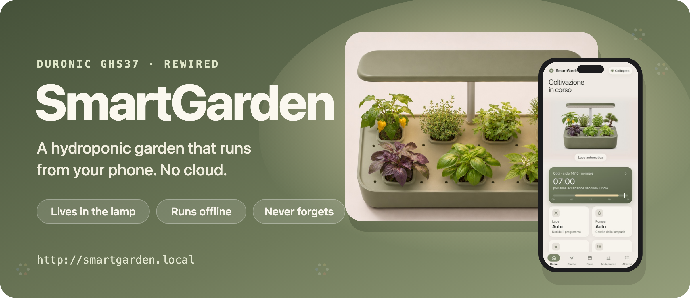
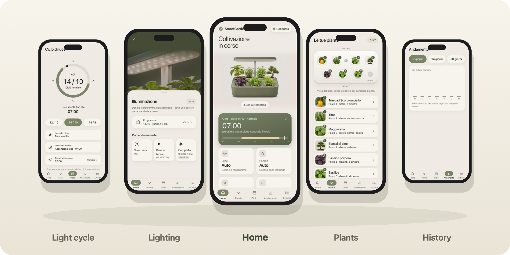
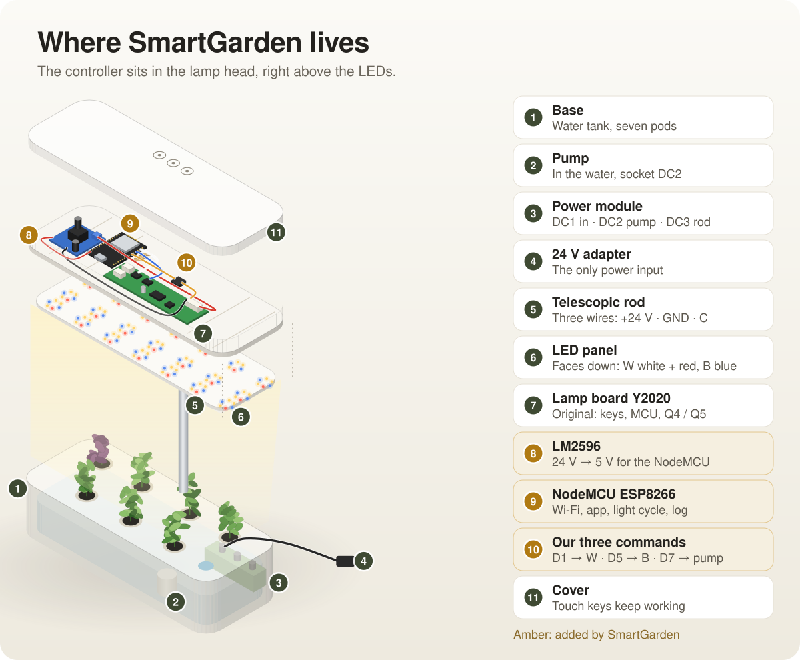
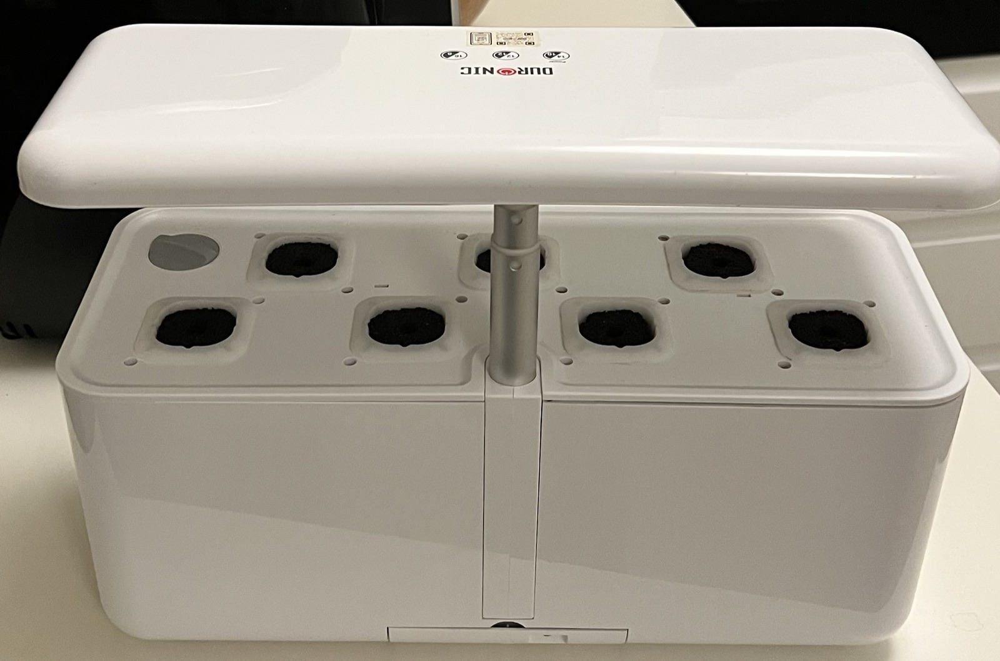
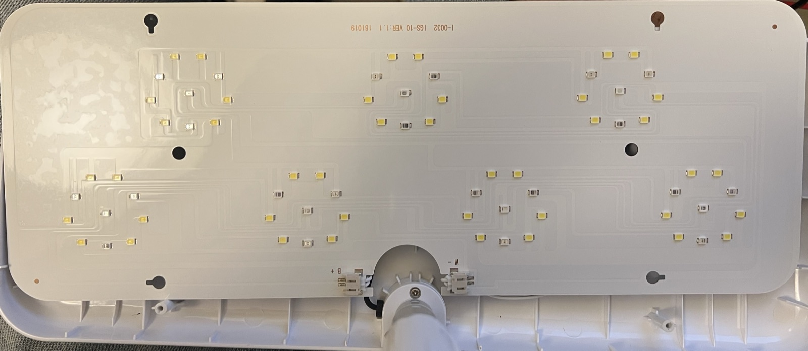
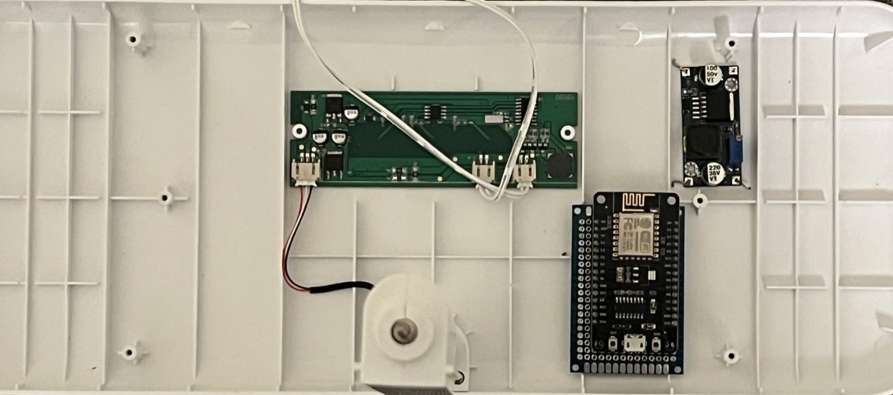
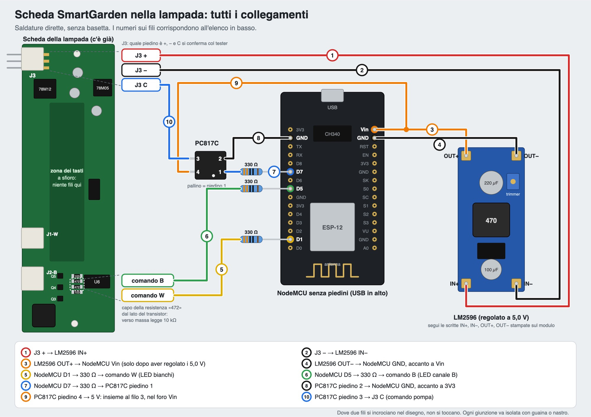

<p align="center">

</p>

<p align="center">


</p>

<p align="center">
A Duronic GHS37 grows seven plants under its LED lamp.<br>
An ESP8266 hidden in the lamp head now drives the lamp's own LED and pump stages,<br>
serves a mobile app at <b><code>http://smartgarden.local</code></b> and remembers everything it does.<br>
No cloud, no account, no hub: the garden keeps its cycle even with the phone off.
</p>

<p align="center">

</p>

## What it does

**💡 Light, from the phone.** White only, white at 50 % (PWM, no visible flicker) or the
full spectrum. Tap the active choice again and the lamp takes control back.

**🌗 A light cycle the board runs by itself.** 12/12, 14/10 or 16/8 from the hour you
choose, each with its own light (12/12 white at 50 %, 14/10 white + blue, 16/8 white).
Settings live on the board: after a power cut the light follows the cycle with no phone
and no button press. A manual choice wins until the next scheduled on/off.

**🌱 Your seven plants.** A top view of the pods, numbered 1–7: set each plant and its
sowing date, the app counts the days. Saved on the board, so every phone sees the same garden.

**📈 History that survives everything.** The board counts the minutes of light of every
day (cycle, manual or the lamp's own) and keeps 60 days; the app shows hours per day. Every
command, boot, Wi-Fi change and cycle change goes into an activity log that survives
reboots and app updates (`firmware/tools/log.sh` prints it on a computer).

**💧 Pump, read-only for now.** The lamp runs it by itself (observed: about 5–6 min on,
30 min off); taking it over is the open hardware point below.

**📲 Installs like an app.** Open `http://smartgarden.local` in Safari → Share →
*Add to Home Screen*: full screen, its own icon, no browser bars. It updates itself when a
new version is uploaded.

## Where it lives

<p align="center">

</p>

Everything happens in the **lamp head**, the flat top part that holds the LEDs. The numbers
match the drawing; amber marks what SmartGarden adds.

1. **Base**: the water tank with seven pods, where the plants grow.
2. **Pump**: sits in the water, plugged into socket DC2.
3. **Power module**: DC1 takes the adapter, DC2 the pump, DC3 the rod's plug; its Q2 switches the pump on command C.
4. **24 V adapter**: the only power input (24 V DC, 25 W).
5. **Telescopic rod**: three wires only: +24 V, GND and the pump command C.
6. **LED panel**: faces down into the garden. W lights the white and red LEDs, B the blue ones; no resistors, fed by the lamp board.
7. **Lamp board "Y2020"**: the original, with touch keys, its own MCU, J3 from the rod and the Q4/Q5 transistors for W and B.
8. **LM2596** (added): 24 V from J3 down to 5.0 V for the NodeMCU.
9. **NodeMCU ESP8266** (added): Wi-Fi, the app, the light cycle, settings and the log.
10. **Our three commands** (added): D1 → 330 Ω → W, D5 → 330 Ω → B, D7 → 330 Ω → PC817C → J3 C for the pump.
11. **Cover**: the top of the head; the lamp's touch keys keep working.

The board can only **add** "on" to a channel; when it releases a pin the lamp's own
controller decides again. Every output is off from power-up until the firmware drives it
on purpose.

## The build

<p align="center"><br>
<sub>The Duronic GHS37 (seen from behind): seven pods, one pole, and on top the flat lamp head, where the LEDs are and where the controller goes.</sub></p>

<p align="center"><br>
<sub>The lamp head from below, cover off: the LED panel, with the pole joint in the middle. The lamp's own board and our controller sit in the same head, behind this panel.</sub></p>

<p align="center"><br>
<sub>The lamp head opened: its own board already has every power stage; NodeMCU and LM2596 laid out before wiring.</sub></p>

<p align="center"><br>
<sub>Rev C inside the lamp head: NodeMCU, LM2596, three 330 Ω, one PC817C, wired to the lamp board.</sub></p>

<p align="center"><br>
<sub>Rev C wiring, every joint numbered (<a href="docs/hardware/wiring-rev-c.svg">SVG</a>).</sub></p>

**The story so far.** The 2023 plan was an external box with MOSFETs. Taking the unit apart
showed that the lamp head already holds one transistor per LED channel and the pump's
command line, all at logic level, while the LED panel has no resistors and the pole carries
only three wires. So the controller moved inside the lamp head
([spec 005](specs/005-lamp-head-controller/spec.md)). An illustrated, step-by-step build
guide in Italian is in [docs/hardware/assembly-guide.html](docs/hardware/assembly-guide.html).

**✅ Confirmed on the real unit**
- W lights the white and red LEDs, B the blue ones; both switch on and off from the app.
- 50 % PWM on W dims the white LEDs with no visible flicker.
- Firmware updates over Wi-Fi work, password-protected and guarded (below).
- The board runs the light cycle from its own clock (NTP) and settings (EEPROM): verified
  switching on at boot and off/on when the start hour is moved.

> [!WARNING]
> **Open: the pump.** Our D7 command does not start the pump: the lamp seems to hold J3 C low and the
> PC817C cannot overcome it (hypothesis, to be measured). Moving our command after the lamp
> MCU, on Q2's control pin, would also let the app switch the pump off. Until then the pump
> is read-only and its timing is logged by hand in
> [docs/hardware/pump-timing-log.md](docs/hardware/pump-timing-log.md).

## The design

Warm off-white surfaces, a muted olive green taken from a ceramic pot, and nothing on
screen that the device cannot actually do: controls without a function are not shown and
no number is made up. The garden on Home is a generated render seen from above and in
front, with the real pod layout; lights on and off cross-fade with the real light state.
Its olive finish is a design choice, the real unit is white.

## Get started

**Run the app on a computer**

```bash
cd app
node dev/server.mjs                                  # simulated lamp
DEVICE=http://smartgarden.local node dev/server.mjs  # the real lamp
```

Then open `http://localhost:5173`.

**Test**

```bash
cd app
npm test               # unit tests
npm run coverage       # with coverage
firmware/test/run.sh   # firmware cycle and history logic, compiled and run on the computer
```

The pure logic (light cycle maths, event log, history, plants, settings storage, device
polling) is unit-tested; the firmware's cycle logic (`schedule.h`) is checked for every
minute of the day, every cycle and every start hour. The UI and the device calls are
checked in the browser.

**Update the lamp**

```bash
firmware/tools/ota-upload.sh firmware/web-test   # firmware
firmware/tools/ota-upload.sh --app               # the app (rewrites the file system; the log is copied across)
```

The script refuses a build that would lose OTA (password check, ArduinoOTA symbols in the
binary), stops if it cannot copy the activity log first, and waits for the board to answer
again; a Claude Code hook blocks any other way of uploading over the network.

## Inside the repository

- [`app/`](app/): the mobile web app. HTML, CSS and ES modules, no build step, no
  dependencies. [Its README](app/README.md) lists every difference from the original mockup and why.
- [`firmware/web-test/`](firmware/web-test/): the firmware running on the lamp: outputs,
  light cycle, event log, app server, OTA.
- [`firmware/tools/`](firmware/tools/): `ota-upload.sh`, the only way to update the board
  over Wi-Fi, and `log.sh`.
- [`docs/`](docs/): project status, hardware audit, wiring, architecture, test plan, photos.
- [`specs/`](specs/): units of work, spec → plan → tasks → checklist.
- [`legacy/schmidt-arduino/`](legacy/schmidt-arduino/): Dominik Schmidt's original controller, kept as reference.

<details>
<summary><b>Firmware API</b></summary>

| Endpoint | |
|---|---|
| `GET /state` | `{w, b, p, wd, bd, pumpLeft, lw, lb}`: forced outputs, PWM duty, lamp line readback |
| `POST /set?ch=w\|b\|p&on=0\|1[&duty=1..99][&src=app]` | Force a channel on (optionally PWM) or release it |
| `POST /release` | Release everything |
| `GET /log?since=<seq>` | Persisted events after `seq`, 300 per page |
| `GET /schedule` | `{cycle, start, enabled, clock, on, next, override}`: the cycle the board runs |
| `POST /schedule?cycle=14/10&start=7&enabled=1` | Change the cycle (saved in EEPROM, applied at once) |
| `GET /plants`, `POST /plants?pod=0..6&name=…&sown=YYYY-MM-DD` | The seven pods, kept in EEPROM |
| `GET /history?days=N` | Minutes of light per day counted by the board, last 60 days kept in EEPROM |
| `GET /logfiles/a.bin` | Raw log file, read-only (used to keep the log across app updates) |
| `GET /test` | The bench test page |

</details>

## How it is built

Development is spec-driven and done together with AI agents: agents start from
[AGENTS.md](AGENTS.md), the principles are in
[.specify/memory/constitution.md](.specify/memory/constitution.md) (safe by default,
evidence before wiring, human approval before any hardware change, flash or push), and the
current state is always in [docs/PROJECT_STATUS.md](docs/PROJECT_STATUS.md).

## Credits

Based on Dominik Schmidt's
[hydroponic-smart-garden-controller](https://github.com/dominik-schmidt/hydroponic-smart-garden-controller)
for the IDOO grow box ([article](https://www.dominikschmidt.net/2021/12/hydropomic-smart-garden-controller/)).
His light scenes are the reference for the three light cycles.
